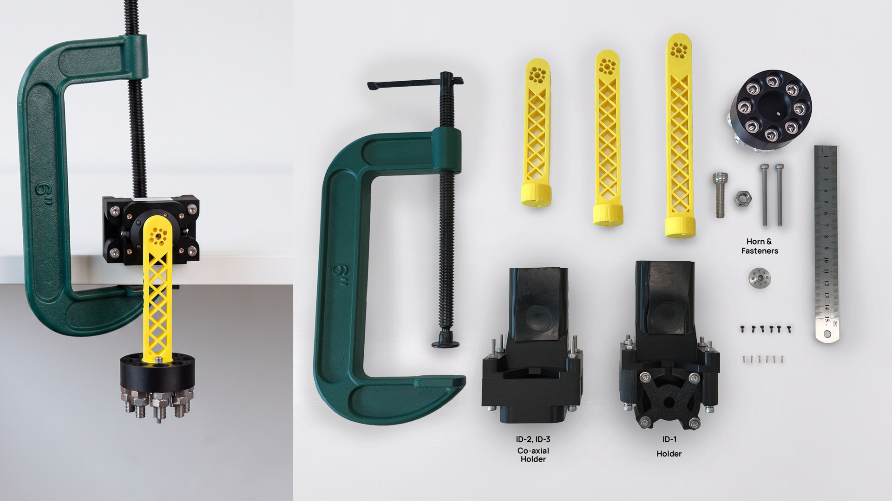

# MD-300-150 BAM identification rig

A test rig for identifying [BAM](https://github.com/Rhoban/bam) (Better
Actuator Models) models of MangDang's MD-300-150 module. The module is clamped
in a printed anchor, a printed pendulum arm with a bolt payload is fixed to the
output under test, and an ESP32-S3 bridge connects the module's AT32 driver
board to the host over USB. The module has three outputs: id_1 (side output),
id_2 (outer coaxial output) and id_3 (inner coaxial output, through a rod),
with AT32 firmware 0.0.9.

The models (`mangdang_md300_id_1`, `_id_2`, `_id_3`), the recorder and the
recording workflow are in BAM, branch
[`md300-voltage`](https://github.com/mangdangroboticsclub/bam/tree/md300-voltage),
under `bam/mangdang/`. The recorded logs are in the release
[`md300-data-v1`](https://github.com/mangdangroboticsclub/bam/releases/tag/md300-data-v1).



## Contents

```
hardware/
  side_anchor/      anchor for id_1 tests
    side_anchor_holder.STL
    side_anchor_housing.STL
    V2_back_portion_holder.STL
  coaxial_anchor/   anchor for id_2 and id_3 tests
    geared_piece_motor_holder.STL
    smooth_piece_motor_holder.STL
    V2_back_portion_holder.STL
    V2_Motor_Holder_Bottom.STL
  pendulum/         arms of 10, 12.5 and 15 cm, payload bed
    10cm_arm.STL  12_5cm_arm.STL  15cm_arm.STL  payload_bed.stl
images/bam_rig.jpg
firmware/           ESP32-S3 USB-serial to SPI bridge (ESP-IDF)
BOM.md              bill of materials
```

The two `V2_back_portion_holder.STL` files differ: print the one in the folder
of the anchor you build.

## Printing and assembly

1. Print the anchor for the output under test: `side_anchor/` for id_1,
   `coaxial_anchor/` for id_2 and id_3. Print the arm length you need and the
   payload bed.
2. Fit the module in the anchor and clamp the anchor to the bench, so the
   module cannot move.
3. Fix the pendulum arm to the output under test (screws in `BOM.md`; on
   id_2, M2 nuts as spacers keep the arm clear of the housing).
4. Bolt the payload to the payload bed with M8 bolts and nuts, and fix the bed
   to the arm's end: the payload's centre sits 2 cm beyond the arm's end.
   Weigh the arm and the payload; the recorder takes both masses and the
   lengths (see Recording).

See [BOM.md](BOM.md) for the parts.

## Bridge firmware

`firmware/` builds with ESP-IDF v6.0 for MangDang's MP4 ESP32 CORE board
(ESP32-S3). With Docker, from `firmware/`:

```bash
docker run --rm -u $(id -u):$(id -g) -e HOME=/tmp -v "$PWD":/project -w /project \
    espressif/idf:v6.0 idf.py build
docker run --rm -u $(id -u):$(id -g) --group-add dialout -e HOME=/tmp \
    --device /dev/ttyUSB0 -v "$PWD":/project -w /project \
    espressif/idf:v6.0 idf.py -p /dev/ttyUSB0 flash
```

Plug the module's cable into one of the board's servo connectors (CN4, CN5,
CN3, CN6: bus ids 1-3, 4-6, 7-9, 10-12), the 12 V supply into the board, and
the board's USB port into the host. The outputs are powered whenever the
supply is connected. Pins, protocol and a standalone tester are in
[firmware/README.md](firmware/README.md).

## Recording

Install BAM from the `md300-voltage` branch and follow
[`bam/mangdang/README.md`](https://github.com/mangdangroboticsclub/bam/blob/md300-voltage/bam/mangdang/README.md)
for recording, processing, the pendulum geometry and fitting. For example,
id_2 of the module on CN3 (bus id 8), 12.5 cm arm and a 161 g payload:

```bash
python -m bam.mangdang.all_record --id 8 --mass 0.16078 --arm-mass 0.01872 --length 0.145 \
    --arm-length 0.125 --payload-offset 0.02 --payload-inertia 7.68e-05 \
    --kps 40,80,120,160 --kd 400 --shuffle --logdir raw \
    --trajectories lift_and_drop,sin_sin,sin_time_square,up_and_down,gait_hip \
    --extra "--zero-dd 1556 --control-mode 1 --pwm-scale 0.001 --max-pwm-duty-cycle 0.99 \
             --ki-position 0 --supply-v 12"
```

`--zero-dd` is the raw position reading (deci-degrees) of the arm hanging
straight down. Measure it with the payload mounted, before each recording:

```
python -m bam.mangdang.zero --id 8 --logdir data_raw
```

It lifts the arm to each side, releases it and prints the midpoint of the rest
positions, which cancels static friction.

## Licence

Copyright 2026 MangDang.

- `firmware/` and other code: Apache License 2.0, see [LICENSE](LICENSE).
- `hardware/` and `images/`: CC BY 4.0, see [LICENSE-CC-BY-4.0](LICENSE-CC-BY-4.0).
